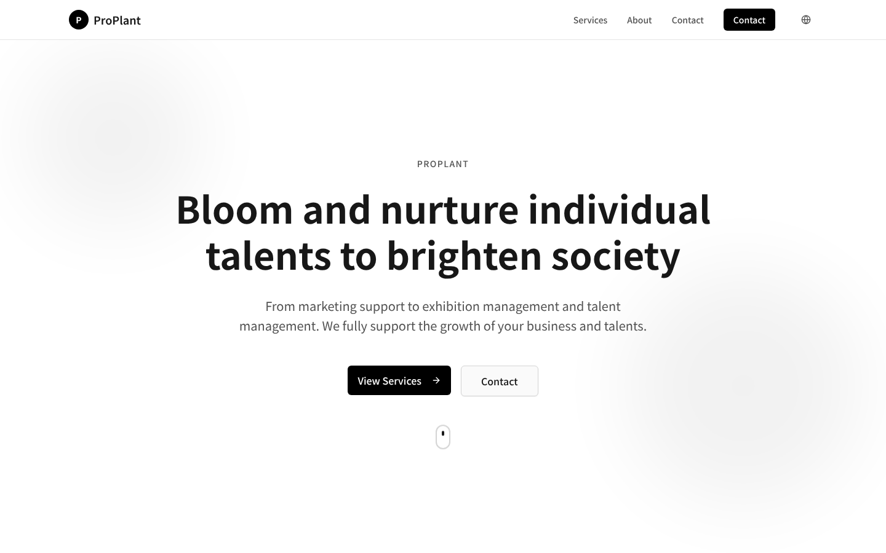
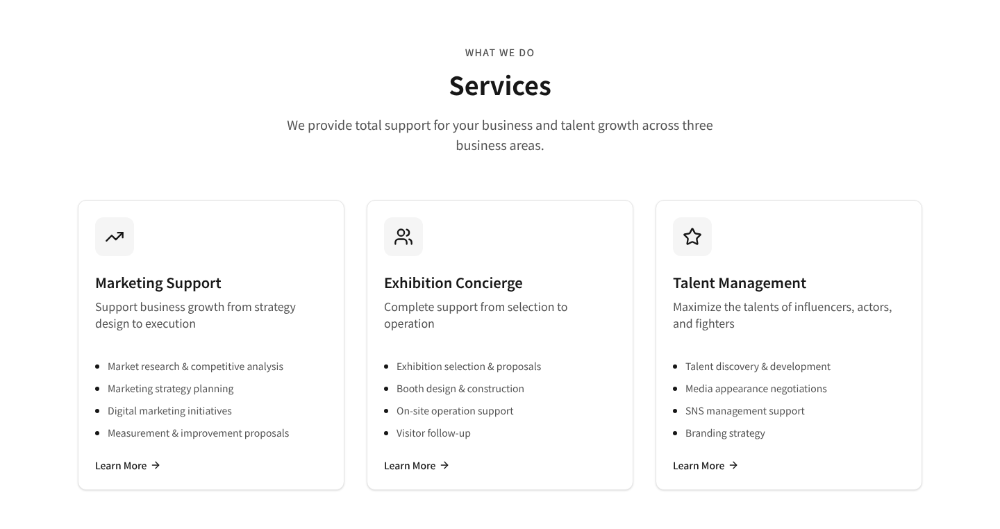
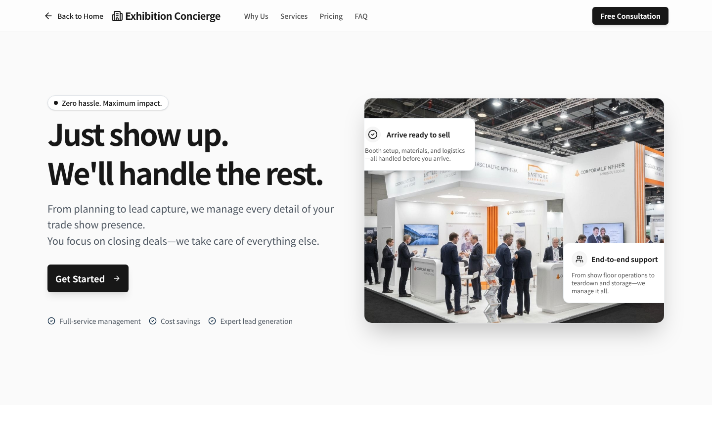
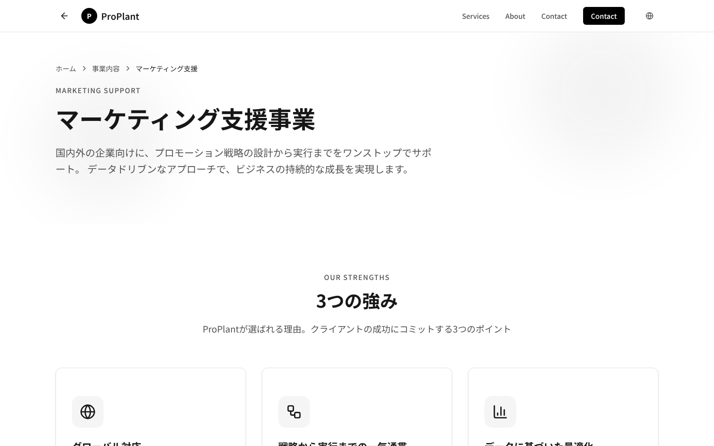
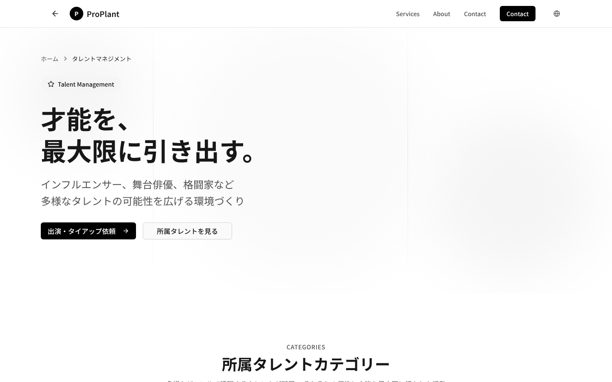
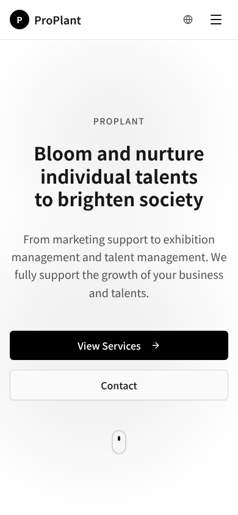

<div align="center">

# 🌱 ProPlant

**Corporate website for ProPlant LLC (ProPlant合同会社)**: a Yokohama-based company that helps businesses and individual talents grow through marketing support, exhibition management, and talent management.

*"Bloom and nurture individual talents to brighten society."*


</div>



---

## Table of Contents

- [Overview](#overview)
- [Features](#features)
- [Pages](#pages)
- [Screenshots](#screenshots)
- [Tech Stack](#tech-stack)
- [Getting Started](#getting-started)
- [Project Structure](#project-structure)
- [Internationalization](#internationalization)
- [Deployment](#deployment)
- [Roadmap](#roadmap)

---

## Overview

ProPlant is a modern, responsive marketing website that presents the company's three business areas and gives each its own landing page. It uses a clean black-and-white design system, is built with the Next.js App Router, and lets visitors switch the main page between four languages.

| Business area | What it covers |
| --- | --- |
| **Marketing Support** | Market research, strategy planning, digital marketing, measurement and improvement, for domestic and global markets |
| **Exhibition Concierge** | Full-service trade show management: show selection, booth design and setup, on-site operations, and visitor follow-up |
| **Talent Management** | Discovering and developing influencers, stage actors, and fighters, plus media negotiations, social media management, and branding |

## Features

- 🌐 **Multilingual home page**: Japanese, English, Arabic, and French, with the visitor's choice saved in `localStorage`
- 📱 **Fully responsive**: mobile-first layouts with a collapsible mobile menu
- 🎨 **Minimal monochrome design**: a consistent grayscale palette built on Tailwind CSS and shadcn/ui
- 🧭 **Dedicated service pages**: each business area has its own detailed landing page
- 📝 **Contact form**: name, email, company, and message fields with a success state
- 💼 **Pricing and FAQ**: the Exhibition Concierge page includes plans and an FAQ accordion
- ⚡ **Static pre-rendering**: every page is pre-rendered at build time for fast loads
- 📊 **Vercel Analytics**: enabled automatically in production

## Pages

| Route | Description |
| --- | --- |
| `/` | Home: hero, services overview, company profile, and contact form |
| `/services/marketing` | Marketing Support: strengths, process, and call to action |
| `/services/exhibition` | Exhibition Concierge: benefits, services, pricing plans, FAQ |
| `/services/talent` | Talent Management: talent categories, approach, and support programs |

## Screenshots

<table>
  <tr>
    <td width="50%"><br><sub><b>Services overview</b></sub></td>
    <td width="50%"><br><sub><b>Exhibition Concierge</b></sub></td>
  </tr>
  <tr>
    <td width="50%"><br><sub><b>Marketing Support</b></sub></td>
    <td width="50%"><br><sub><b>Talent Management</b></sub></td>
  </tr>
</table>

<p align="center">
  <br>
  <sub><b>Mobile view</b></sub>
</p>

## Tech Stack

| Layer | Technology |
| --- | --- |
| Framework | [Next.js 16](https://nextjs.org/) (App Router) |
| UI library | [React 19](https://react.dev/) |
| Language | [TypeScript](https://www.typescriptlang.org/) |
| Styling | [Tailwind CSS 4](https://tailwindcss.com/) + [tw-animate-css](https://github.com/Wombosvideo/tw-animate-css) |
| Components | [shadcn/ui](https://ui.shadcn.com/) on [Radix UI](https://www.radix-ui.com/) primitives |
| Icons | [Lucide](https://lucide.dev/) |
| Forms | React Hook Form + Zod |
| Fonts | Inter and Noto Sans JP via `next/font` |
| Analytics | Vercel Analytics |
| Hosting | [Vercel](https://vercel.com/) |

## Getting Started

### Prerequisites

- [Node.js](https://nodejs.org/) 20 or later
- npm (or pnpm)

### Installation

```bash
# Clone the repository
git clone https://github.com/mechanicb0y/ProPlant.git
cd ProPlant

# Install dependencies
npm install

# Start the development server
npm run dev
```

Then open [http://localhost:3000](http://localhost:3000) in your browser.

### Available Scripts

| Command | Description |
| --- | --- |
| `npm run dev` | Start the development server with hot reload |
| `npm run build` | Create an optimized production build |
| `npm run start` | Serve the production build |

## Project Structure

```
ProPlant/
├── app/
│   ├── layout.tsx              # Root layout: fonts, metadata, language provider
│   ├── page.tsx                # Home page
│   ├── globals.css             # Global styles and design tokens
│   └── services/
│       ├── marketing/page.tsx  # Marketing Support page
│       ├── exhibition/page.tsx # Exhibition Concierge page
│       └── talent/page.tsx     # Talent Management page
├── components/
│   ├── header.tsx              # Navigation and language switcher
│   ├── hero-section.tsx
│   ├── services-section.tsx
│   ├── about-section.tsx
│   ├── contact-section.tsx
│   ├── footer.tsx
│   ├── exhibition/             # Sections used by the Exhibition page
│   └── ui/                     # shadcn/ui components
├── contexts/
│   └── language-context.tsx    # Language state and persistence
├── lib/
│   ├── translations.ts         # All translated strings (ja / en / ar / fr)
│   └── utils.ts
├── hooks/                      # Shared React hooks
└── public/                     # Images and icons
```

## Internationalization

The home page's text lives in [`lib/translations.ts`](lib/translations.ts), keyed by language code. The current language comes from `LanguageProvider` in [`contexts/language-context.tsx`](contexts/language-context.tsx) and is saved in the browser so it persists between visits.

To edit or add text:

1. Add the key to **every** language object in `lib/translations.ts` (`ja`, `en`, `ar`, `fr`).
2. In a component, read the active language with `useLanguage()` and look up the string:

```tsx
const { language } = useLanguage();
const t = translations[language];

return <h1>{t.heroTitle}</h1>;
```

Japanese (`ja`) is the default language.

## Deployment

The project is set up for [Vercel](https://vercel.com/):

1. Import the repository in the Vercel dashboard.
2. Keep the default Next.js settings (build command `next build`).
3. Deploy. Every push to `main` then triggers a new deployment.

The site also runs on any Node.js host with `npm run build && npm run start`.

## Roadmap

- [ ] Connect the contact form to a real email or API backend (it currently simulates sending)
- [ ] Extend the language switcher to the service pages
- [ ] Add right-to-left (RTL) layout support for Arabic
- [ ] Remove unused placeholder assets from `public/`
- [ ] Add SEO metadata and Open Graph images for each language

---

<div align="center">

© 2020–present **ProPlant LLC**. All rights reserved.

</div>
